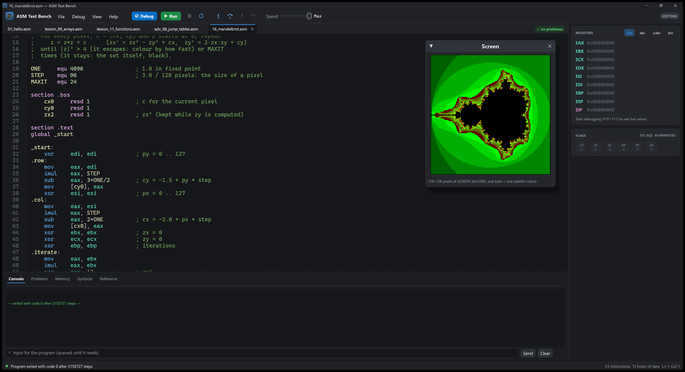

# ASM Test Bench

An educational IDE for **32-bit x86 assembly** (NASM-style Intel syntax) with a built-in
emulator and a visual debugger. Made for writing and understanding small programs: no NASM,
linker or Linux needed. Everything runs inside the app.



## Download

**[Download asm_test_bench.zip](https://github.com/zeroskew/ASM_Test_Bench/releases/latest/download/asm_test_bench.zip)**
(latest release). Unzip and run `asm_test_bench.exe`; there is no installer. All releases are on
the [Releases page](https://github.com/zeroskew/ASM_Test_Bench/releases). ASM Test Bench updates
itself: it checks for a new release at start-up and every few hours, downloads it in the
background and, when you restart, installs it over the exe you started (Help > Check for
updates; untick Help > Check for updates automatically to turn the automatic checks off).

## Features

- **Editor**: syntax highlighting (comments in italics; View > Italic comments turns that off), line numbers, errors underlined as you type, auto-indent,
  Ctrl+/ to comment lines, hover help for instructions, registers, labels and numbers
  (numbers show decimal / hex / binary / character; while debugging, a register shows its
  live value, its previous value if the last step changed it, and what it points to).
  Tab moves to the next 4-column tab stop (indents a multi-line selection), Shift+Tab
  unindents. **Align operands** (View menu, on by default): Space after an instruction
  pads to the operand column (12 by default), so `mov`␣ lines up like the examples.
  **Align comments** (View menu, on by default): typing `;` after code moves it to the comment
  column (28 by default) when the line is short enough.
  **Autocomplete** (View menu, on by default): while you type a word, a list opens under it
  with what fits there and a short description of each: instructions and directives at the
  start of a statement, registers, your variables, labels and constants in operands (labels
  first after a jump or call, variables first inside `[ ]`), `.text / .data / .bss` after
  `section`. Up / Down choose, Enter or Tab inserts, Esc closes, Ctrl+Space opens it any time.
- **Tabs**: every opened file, example or new document gets its own tab, with its own
  breakpoints, debugging session, cursor and undo history (a running program pauses when you
  switch away). Ctrl+Tab goes to the tab you used before, so pressing it again flips back;
  holding Ctrl and pressing Tab again goes further back (it stops at the oldest rather than
  wrapping round). Close with the tab's ×, a middle-click or Ctrl+W; unsaved changes are
  asked about first. Open tabs are restored the next time the app starts.
- **Debugger**: breakpoints (click the gutter or F9), Run / Pause, Step Into, Step Over,
  Step Out, **Step Back** (undo instructions), Run to cursor (right-click), adjustable speed
  (slow speeds animate the execution line by line).
- **Inspector**: registers (changed values glow, hex / dec / signed / binary), the next instruction,
  flags with explanations and which conditional jumps would be taken, the call stack, and
  the stack with ESP / EBP markers, return addresses, saved EBP and arguments labelled.
- **Bottom panel**: Console (output and input), Problems, Memory (hex dump with symbols and
  changed bytes highlighted), Symbols, and a Reference of every supported instruction,
  system call, register and flag.
- The bottom panel and the inspector are resizable: drag their edge next to the editor.

## Shortcuts

| Key | Action |
|---|---|
| F5 | Run / Continue |
| F6 | Pause |
| Shift+F5 | Stop |
| Ctrl+Shift+F5 | Reset to the entry point |
| F7 / Ctrl+B | Debug: assemble and pause at the entry point |
| F9 | Toggle breakpoint on the cursor line |
| F10 / F11 | Step Over / Step Into |
| Shift+F11 | Step Out |
| Shift+F10 | Step Back |
| Ctrl+N / Ctrl+O / Ctrl+S | New / Open (each in a new tab) / Save |
| Ctrl+Tab | Previously used tab (keep Ctrl held and press Tab again to go further back) |
| Ctrl+Shift+Tab | The other way through the recently used tabs |
| Ctrl+W / Ctrl+F4 | Close the tab |
| Ctrl+/ | Comment / uncomment lines |
| Ctrl+Space | Open the autocomplete list |
| Ctrl+= / Ctrl+- | Code font size |

## The machine

- 128 KiB of memory: code at `0x1000`, data at `0x4000` (then `.bss`), the screen at
  `0xC000`–`0xFFFF`, and the stack growing down from `0x20000`.
- Each instruction takes a 4-byte slot (there's no real x86 machine-code encoding).
- The program starts at `_start` (or `main`, or the first instruction). `main` is "called",
  so it can end with `ret`; EAX is then the exit code.
- Faults stop the program with a friendly explanation and leave EIP at the faulting line:
  division by zero / overflow (with a hint about EDX), null or out-of-range pointers,
  writes into the code segment, stack overflow / underflow, running past the end.

### Supported syntax

`section .text/.data/.bss`, labels (`name:`), local labels (`.loop`), `equ`, `$` and `$$`,
`db / dw / dd`, `resb / resw / resd`, `times`, `align`, strings in `'…'`, `"…"` and `` `…\n` ``,
numbers in decimal, `0x1F`, `1Fh`, `0b101`, `101b`, `17o`, characters `'A'`, constant
expressions, and memory operands `[base + index*scale + disp]` with `byte / word / dword`.

### Instructions

mov, movzx, movsx, lea, xchg, xadd, cmpxchg, bswap, xlat, push, pop, pushad, popad, pushfd,
popfd, add, adc, sub, sbb, inc, dec, neg, cmp, mul, imul (1/2/3 operands), div, idiv, cbw, cwde,
cwd, cdq, and, or, xor, not, test, bt, bts, btr, btc (also on bit arrays in memory), bsf, bsr,
popcnt, shl/sal, shr, sar, rol, ror, rcl, rcr, shld, shrd, jmp, all jcc, setcc, cmovcc, loop,
loope/loopz, loopne/loopnz, jecxz, call, ret (n), enter, leave, int 0x80, int3, nop, hlt, clc,
stc, cmc, cld, std, lahf, sahf, and the string instructions movs/stos/lods/cmps/scas (b/w/d) with
rep / repe / repne. (No floating point.)

### System calls (`int 0x80`, number in EAX)

Linux numbers and conventions: arguments in EBX, ECX, EDX; the result in EAX; a failure returns
**-errno** (e.g. -2 = ENOENT, no such file), which the Registers panel names next to EAX.

| EAX | Call | Arguments |
|---|---|---|
| 1 | exit | EBX = exit code |
| 3 | read | EBX = fd (0 = console: one line), ECX = buffer, EDX = max bytes; EAX = bytes read (0 = end of file) |
| 4 | write | EBX = fd (1 / 2 = console), ECX = address, EDX = length |
| 5 | open | EBX = file name, ECX = flags (`O_RDONLY O_WRONLY O_RDWR`, `O_CREAT O_EXCL O_TRUNC O_APPEND`); EAX = fd |
| 6 | close | EBX = fd |
| 8 | creat | EBX = file name: create / empty it for writing; EAX = fd |
| 10 | unlink | EBX = file name: delete it |
| 13 | time | EAX = seconds since 1970 (also stored at EBX if not 0) |
| 19 | lseek | EBX = fd, ECX = offset, EDX = `SEEK_SET / SEEK_CUR / SEEK_END`; EAX = new position |
| 20 | getpid | EAX = 1 |
| 38 | rename | EBX = old name, ECX = new name |
| 39 / 40 | mkdir / rmdir | EBX = folder name |
| 45 | brk | EBX = new end of the heap (0: just ask); EAX = the end. The heap starts after .data / .bss |
| 200 | print_int | EBX (signed) |
| 201 | print_char | BL |
| 202 | print_string | EBX = address of a 0-terminated string |
| 203 | read_int | result in EAX |
| 204 | print_hex | EBX |
| 205 | print_newline | |
| 206 | print_uint | EBX (unsigned) |
| 210 | clear_screen | EBX = colour |
| 211 | set_pixel | EBX = x, ECX = y, EDX = colour |
| 212 | fill_rect | EBX = x, ECX = y, EDX = width, ESI = height, EDI = colour |
| 213 | wait_frame | waits for the next frame (~60 per second) |
| 214 | read_key | EAX = next key pressed in the Screen window, 0 if none |
| 215 | key_down | EBX = key code; EAX = 1 while held |
| 216 | random | EBX = n; EAX = 0 .. n-1 |
| 217 | get_ticks | EAX = frames waited so far |

200 and up are ASM Test Bench helpers (not Linux) that make printing numbers and drawing easy
for beginners.

### Files

A program's files live in **one folder**: the folder of its `.asm` file once saved, otherwise
`Documents\ASM Test Bench` (File > Open Files Folder shows it). Names may use `/` or `\` and
subfolders; `..` and drive letters are refused (-13, EACCES), so a program can't reach anything
outside that folder. Up to 16 files can be open at once (file descriptors 3 and up). Step Back
works as usual but can't go back past a file operation: a written file can't be "un-written".

### Screen and keyboard

The **Screen** window (View menu; it also opens by itself when a program draws) shows a
128×128 display mapped at `SCREEN` (`0xC000`): pixel (x, y) is the byte at
`SCREEN + y*SCREEN_W + x`, and its value is a colour from the xterm-256 palette (0–15 basic
colours, 16–231 an RGB cube `16 + 36·r + 6·g + b`, 232–255 greys).

```
mov     byte [SCREEN + 10*SCREEN_W + 20], RED     ; pixel (20, 10)
```

Built-in constants: `SCREEN`, `SCREEN_W`, `SCREEN_H`, `KEY_LEFT/RIGHT/UP/DOWN`, `KEY_SPACE`,
`KEY_ENTER`, `KEY_ESC`, the colours `BLACK GRAY RED GREEN YELLOW BLUE MAGENTA CYAN WHITE`, and for
files `O_RDONLY O_WRONLY O_RDWR O_CREAT O_EXCL O_TRUNC O_APPEND`, `SEEK_SET SEEK_CUR SEEK_END`,
`STDIN STDOUT STDERR`
(a program's own labels take priority). Click the Screen window to send keys to the program;
letters arrive as upper-case ASCII. Drawing is just memory, so Step Back undoes pixels too.
`asm_test_bench.exe file.asm --run` opens a file and starts it.

## Tutorial

The `tutorial` folder is a course in seventeen lessons (File > Tutorial, or Help > Start the
tutorial). Each lesson is a small program whose comments explain one new idea, say what to
watch while stepping through it, and end with **TRY IT** exercises:

| # | Lesson | # | Lesson |
|---|---|---|---|
| 1 | Your first program (instructions, registers, exit) | 10 | The stack (push / pop) |
| 2 | Printing text (`db`, `equ $ -`, write) | 11 | Functions (call / ret) |
| 3 | Registers and numbers (AX / AH / AL, printing) | 12 | Stack frames (EBP, arguments, locals) |
| 4 | Adding and subtracting | 13 | Strings (bytes, characters, pointers) |
| 5 | Multiplying and dividing (`cdq`, remainder) | 14 | Reading input |
| 6 | Comparing and jumping (if / else, flags) | 15 | Working with bits (and / or / xor / shifts) |
| 7 | Loops | 16 | Drawing on the screen |
| 8 | Variables in memory (`[ ]`, sizes, `.bss`) | 17 | Files (open / write / read / lseek / close) |
| 9 | Arrays (`[base + i*4]`) | | |

### Advanced tutorial

The `advanced` folder (File > Advanced Tutorial) goes on with real algorithms, in the same
style:

| # | Lesson |
|---|---|
| 1 | Recursion: the Towers of Hanoi |
| 2 | Numbers bigger than 32 bits (adc / sbb, 64-bit mul, shld, hex printing with xlat) |
| 3 | Bit arrays: the sieve of Eratosthenes (bt / bts, popcnt, bsr) |
| 4 | String instructions: strlen, memcpy, strcmp (rep movsb, repne scasb, repe cmpsb) |
| 5 | The heap and a linked list (brk, a bump allocator, reversing a list) |
| 6 | Processing a file: a small "wc" (reading in chunks, mkdir / unlink / rmdir) |
| 7 | Numbers ↔ text without the helpers (itoa / atoi, any base) |
| 8 | Jump tables and function pointers (`jmp [table + i*4]`, `call [ops + i*4]`) |

## Examples

The `examples` folder has nineteen commented programs, from Hello World to recursion, sorting,
strings, console input (including a simple "add two numbers"), drawing, animation (a bouncing
ball, a round ball with exact bounces, two points joined by a bouncing line drawn with
Bresenham's algorithm), keyboard input (painting with the arrow keys), and three bigger ones: the Game of Life,
the Mandelbrot set (fixed-point arithmetic) and 50! computed exactly (big numbers). Lessons and
examples are built into the exe (File > Tutorial / Advanced Tutorial / Examples): they open as
an unsaved document, and Save stores your own copy. The build embeds every `.asm` file in
`tutorial/`, `advanced/` and `examples/`, so to add one just drop the file there and rebuild
(`build.cmd test` checks that every lesson runs and prints what it promises).

## Building

```
build.cmd build --release      (cargo inside the VS 2022 developer environment; every
                               successful --release build is copied into dist\)
build.cmd test                 (assembler, emulator and example tests)
dist.cmd                       (same as build.cmd build --release; the examples are inside the exe)
build_publish_exe.cmd [-y]     (release build into target\release, zips that exe and publishes
                               it as a GitHub Release tagged v<build version>; -y skips the prompt)
backup.cmd [folder]            (zip of the sources into backups\)
```

Rust + egui/eframe 0.37. The exe links the C runtime statically. Every build is stamped with a
version (UTC build time, `YYYY.MM.DD-HHMM`; `asm_test_bench.exe --version` prints it), which is
what the self-update (`src\update.rs`, `tools\relauncher.rs`) compares with the latest release's
tag. Builds run from a cargo `target` folder don't check automatically.
`build.cmd run --example mkicon` regenerates the icon (`tools\mkicon.rs` → `assets\`); build.rs
embeds it in the exe with the Windows SDK's rc.exe. `tools\capture.ps1` screenshots the running
app without sending any input.
